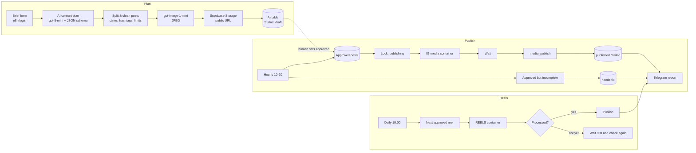
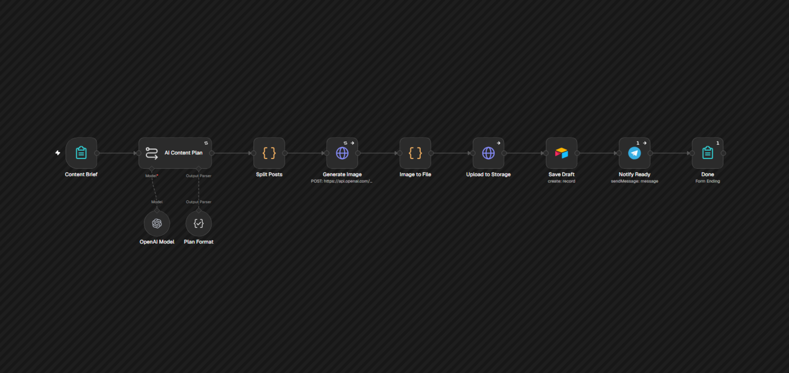
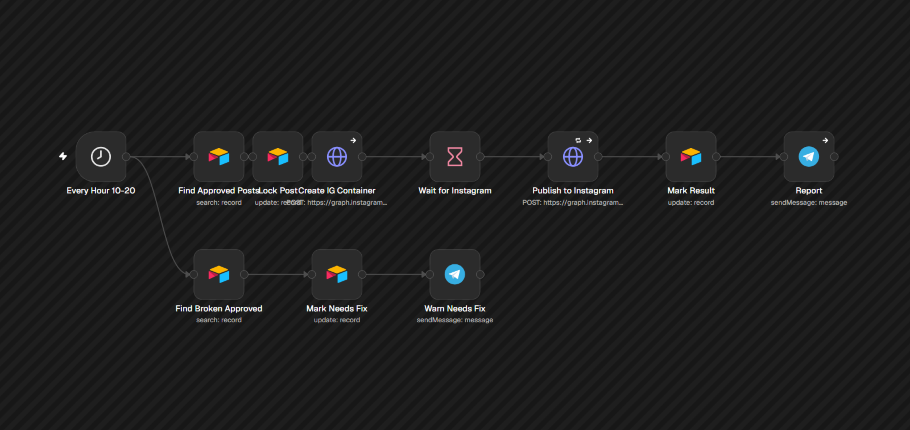
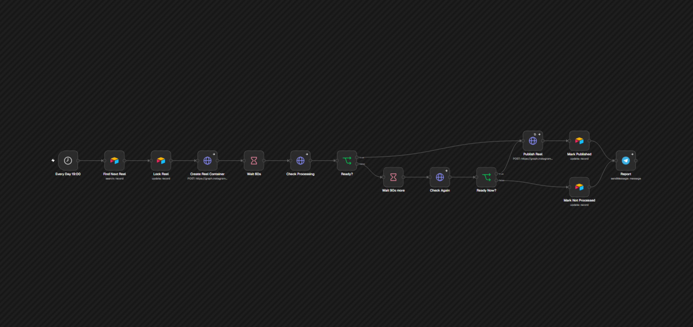

# AI SMM Agent — content plan, images and Instagram autoposting

An AI social-media assistant: fill in a short brief and it writes a content plan with captions and hashtags, **generates an image for every post**, saves everything to Airtable as drafts — and after a human approves a post, **publishes it to Instagram automatically** on its date. A third workflow publishes one approved **Reel** every day at 19:00.

Built with **n8n**, **OpenAI** (text + images), **Supabase Storage** and the **Instagram Graph API**. I use it for my own Instagram account.

🎬 **Demo video (Armenian):** [5-smm-agent-hy.mp4](https://czibuahmksmifbzapnkv.supabase.co/storage/v1/object/public/smm-images/videos/5-smm-agent-hy.mp4)

---

## Problem

Small businesses know they should post regularly, but writing captions, making visuals and remembering to publish takes hours every week, so accounts go quiet. Fully automatic posting is risky, though — nobody wants AI to publish something wrong under their brand.

## Solution

Three n8n workflows with a **human approval step** in the middle:

1. **Content Planner** — brief form → AI plan (1–7 posts) → image per post → public image URL → Airtable `draft`.
2. **Photo Publisher** — every hour 10:00–20:00 publishes posts with `Status = approved` whose date has come.
3. **Daily Reels** — every day at 19:00 (Yerevan) publishes the next approved video.

Nothing is posted until a person changes the status to `approved` in Airtable.

## How it works



## Features

- Brief form: business, audience, goal, language (Russian / Armenian / English), number of posts, start date, wishes
- Content mix (problem, case, tip, behind the scenes, offer); no fake numbers, no fake clients
- Dates computed in code: never in the past, one post every 2 days
- Image per post in one consistent style, with "no text in image" rules
- **Human-in-the-loop:** drafts → approved → published
- Lock status (`publishing`) so a post is never published twice
- Approved posts missing an image, date or caption are marked `needs fix` with a Telegram warning
- Reels: waits for Instagram video processing, checks status, retries once, then marks `failed` with the reason
- Every result reported to Telegram

## Tech stack

`n8n` · `OpenAI gpt-5-mini` · `OpenAI gpt-image-1-mini` · `Supabase Storage` · `Instagram Graph API` · `Airtable` · `Telegram Bot API`

## Repository structure

```
workflow/
  1-content-planner.json
  2-instagram-photo-publisher.json
  3-daily-reels-publisher.json
samples/
  post1.jpg, post2.jpg   # images generated by the planner
```

## Setup

1. Import the three files from `workflow/` into n8n.
2. Select your own credentials (removed from the export):
   - *OpenAI* (text + image generation)
   - *Supabase API* (service_role key) — for uploading images
   - *Header Auth* for Instagram: `Authorization: Bearer <Instagram long-lived token>` of a Business/Creator account
   - *Airtable token*, *Telegram Bot*
3. **Supabase Storage:** create a **public** bucket `smm-images` (allow `image/jpeg`, and `video/mp4` for reels).
4. **Airtable:** create a `Content Plan` table with fields
   `Topic`, `Publish Date` (date), `Format` (`photo` / `reel`), `Caption` (long text), `Image Idea`, `Image URL` (image or video URL), `Status` (`draft`, `approved`, `publishing`, `published`, `failed`, `needs fix`), `Post ID`.
5. Replace placeholders:

   | Placeholder | What it is |
   |---|---|
   | `YOUR_SUPABASE_PROJECT_REF` | The `xxxx` in `https://xxxx.supabase.co` (nodes *Upload to Storage*, *Save Draft*) |
   | `YOUR_AIRTABLE_BASE_ID` | Airtable base id (`app…`) |
   | `YOUR_AIRTABLE_CONTENT_PLAN_TABLE_ID` | Airtable table id (`tbl…`) |
   | `YOUR_TELEGRAM_CHAT_ID` | Chat for reports |

6. Change the default brief text in the **Content Brief** form to your business.
7. Publish all three workflows, open the planner form, then approve a draft in Airtable.

> Instagram long-lived tokens expire after ~60 days — refresh the token before that.

## Screenshots / video

- 🎬 Demo video: [watch](https://czibuahmksmifbzapnkv.supabase.co/storage/v1/object/public/smm-images/videos/5-smm-agent-hy.mp4)
- Generated images: [`samples/post1.jpg`](samples/post1.jpg), [`samples/post2.jpg`](samples/post2.jpg)

**Content planner**



**Instagram photo publisher**



**Daily Reels publisher**



## What I learned

- Instagram publishing is two steps (create container → publish) and needs a **public URL**, so generated images go to public storage first.
- Videos need processing time: publishing a Reel right after creating the container fails; you have to poll `status_code` until `FINISHED`.
- Dates and limits are safer in code than in the prompt — the model sometimes suggested dates in the past.
- A lock status prevents double posting when a run overlaps or is retried.
- Keeping a human approval step makes clients much more comfortable with "AI posts for you".

---

Made by **Sergo Abrahamyan** — AI Automation Engineer, Yerevan · [LinkedIn](https://www.linkedin.com/in/sergo-abrahamyan-2b6290432/) · [GitHub](https://github.com/sergo-abrahamyan-ai)
